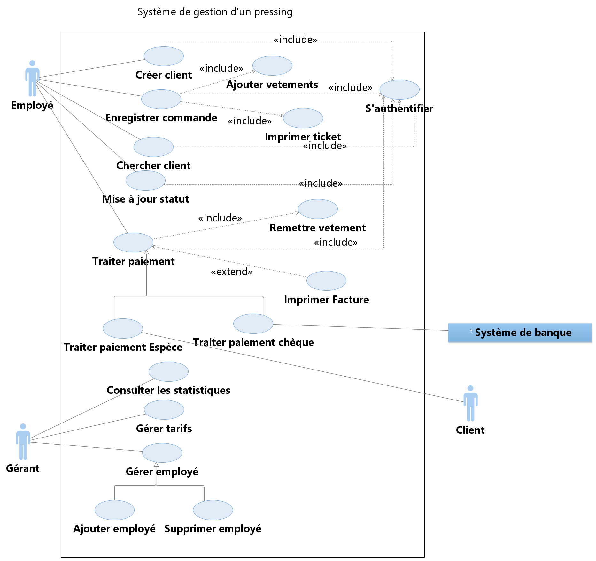
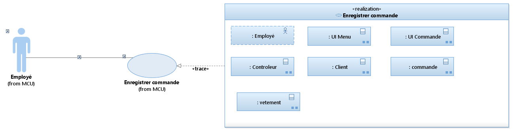
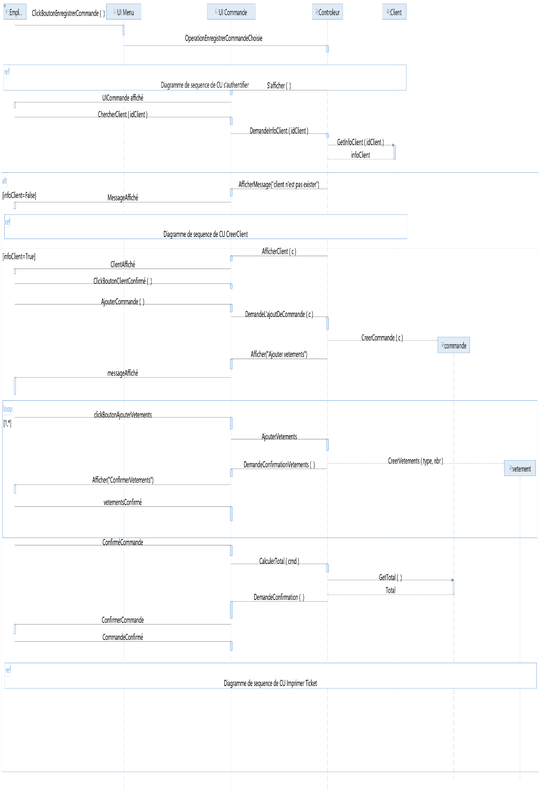
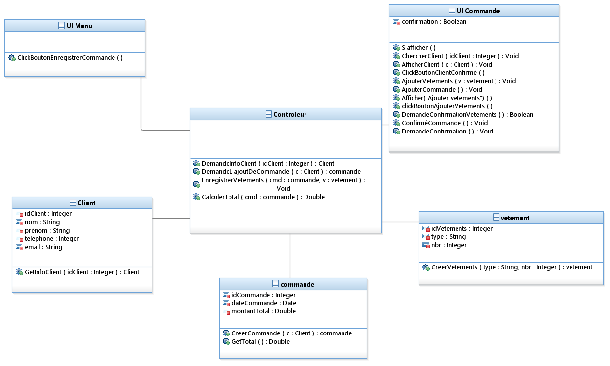
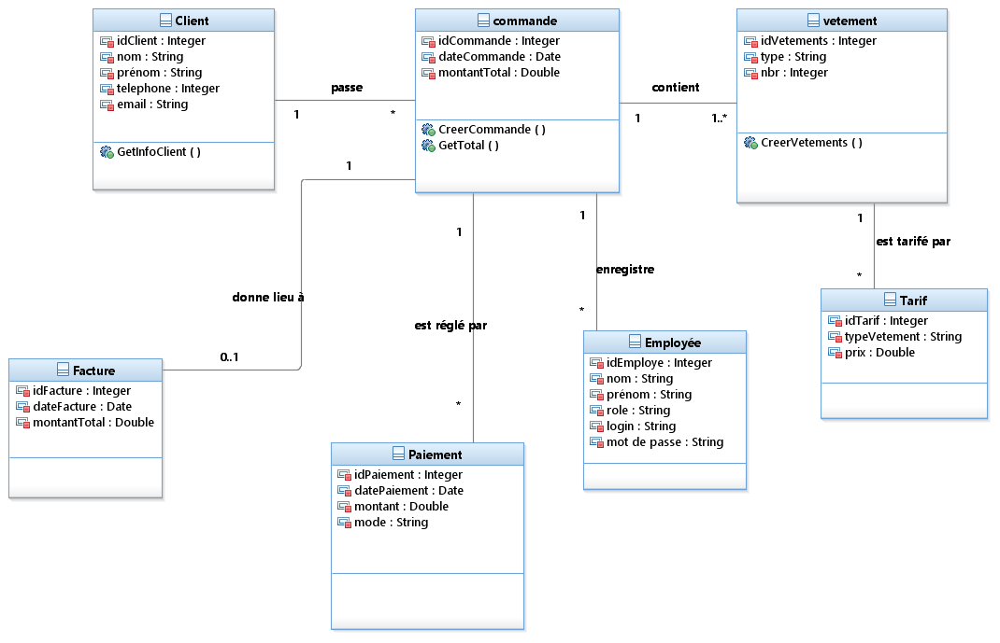
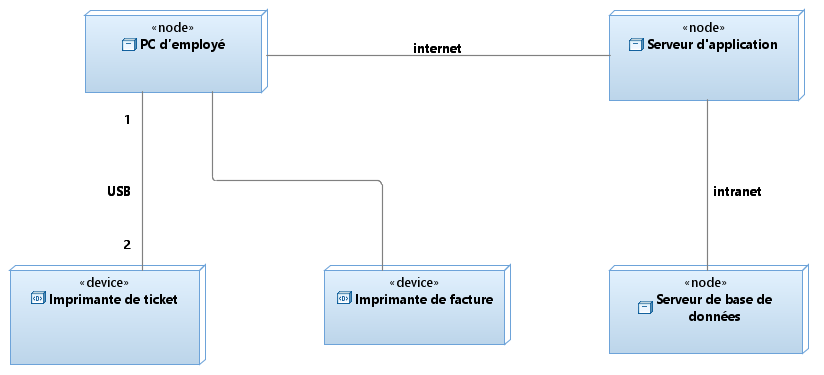
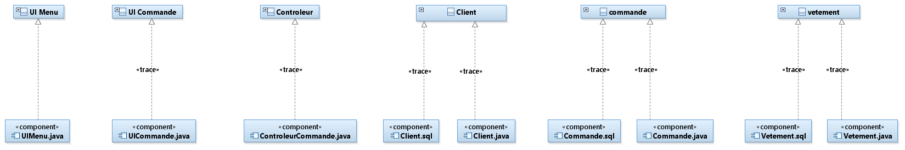
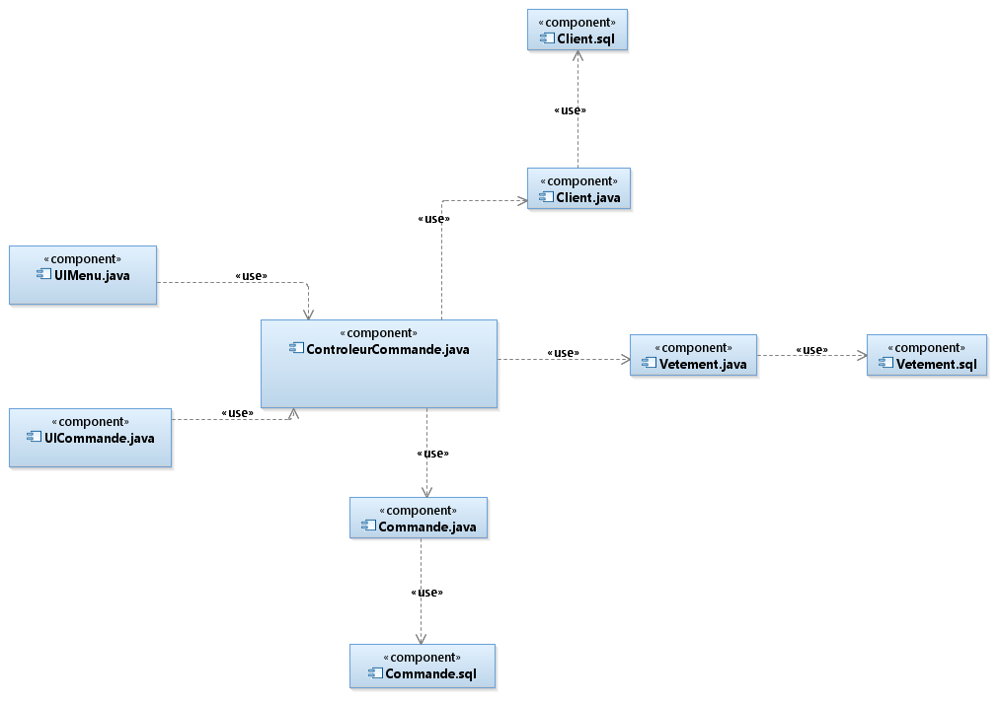

# Gestion d'un pressing

Projet de modélisation UML (Processus Unifié) fait avec IBM Rational Software Architect.

## Objectif
Le but du projet est de modéliser un système de gestion d'un pressing : enregistrer les commandes des clients, gérer les vêtements, les paiements, les tickets et les factures, et permettre au gérant de gérer les employés et les tarifs.

## Acteurs
- Employé : enregistre les commandes et gère les clients et les vêtements
- Gérant : gère les employés et les tarifs, et consulte les statistiques
- Client : dépose ses vêtements et paie sa commande
- Système de banque : traite les paiements par chèque

## Cas d'utilisation
Les principaux cas d'utilisation sont : créer client, chercher client, enregistrer commande, ajouter vêtements, imprimer ticket, mettre à jour le statut, traiter le paiement (espèce ou chèque), imprimer facture, s'authentifier, gérer les employés, gérer les tarifs et consulter les statistiques.

Dans le rapport, j'ai détaillé le cas « Enregistrer commande ».

## Les modèles
- MCU : modèle des cas d'utilisation
- MC : modèle de conception
- MI : modèle d'implémentation
- MD : modèle de déploiement

Les fichiers .emx s'ouvrent avec IBM Rational Software Architect.

## Conception
Traçabilité entre MCU et MC :

Diagramme de séquence de « Enregistrer commande » :

Diagramme de classes de « Enregistrer commande » :

Diagramme de classes entity du système complet :

Diagramme de déploiement :

## Implémentation
Traçabilité entre MC et MI :

Diagramme de composants :

## Rapport
Le rapport du projet est dans le dossier docs.
